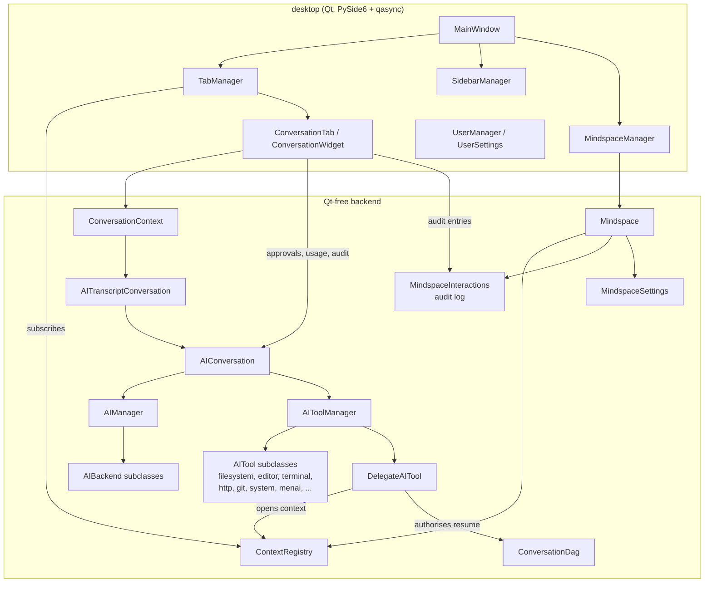
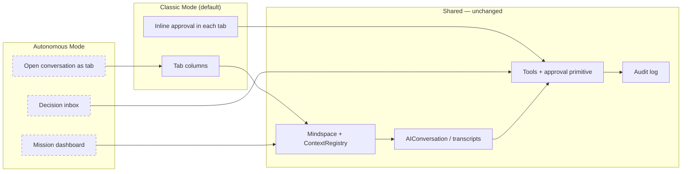
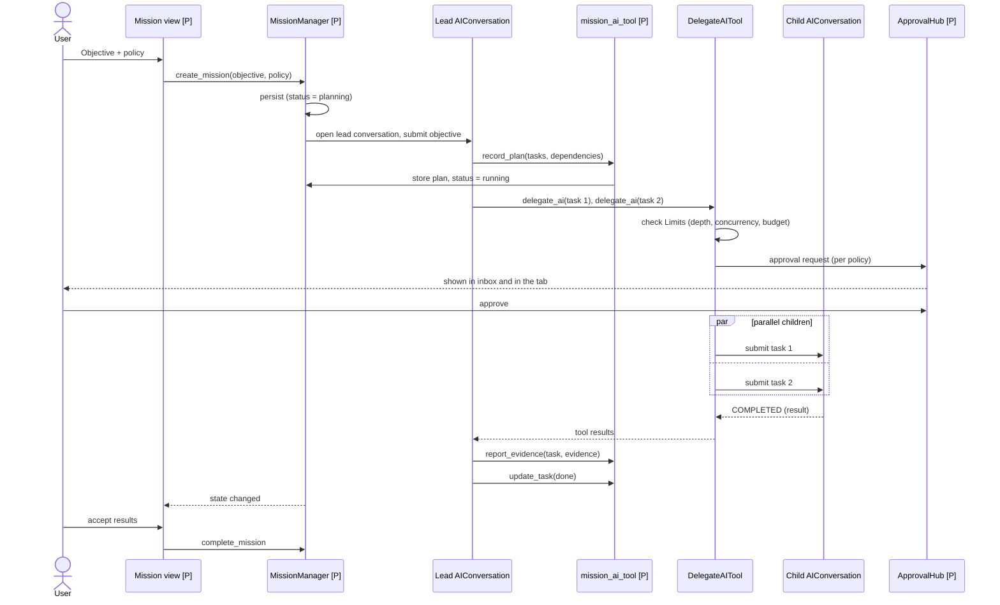
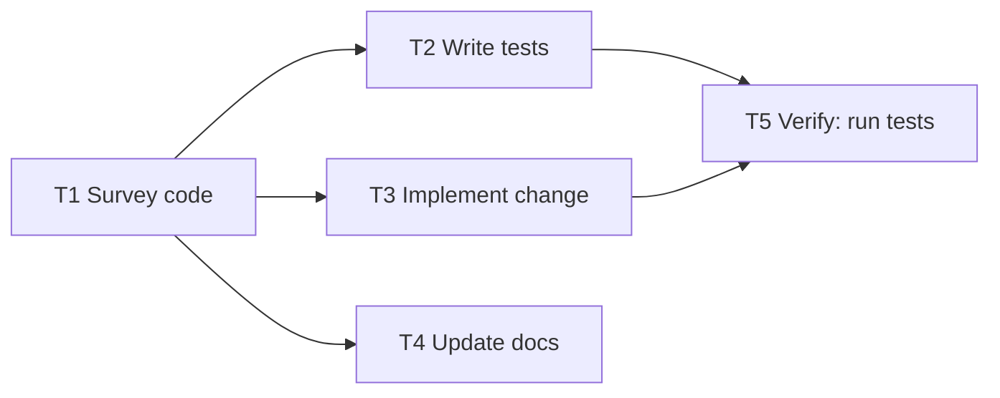
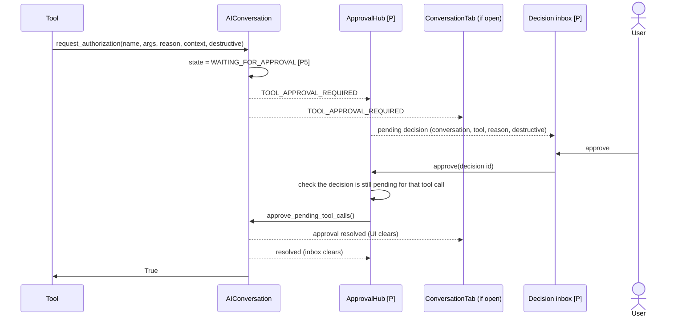
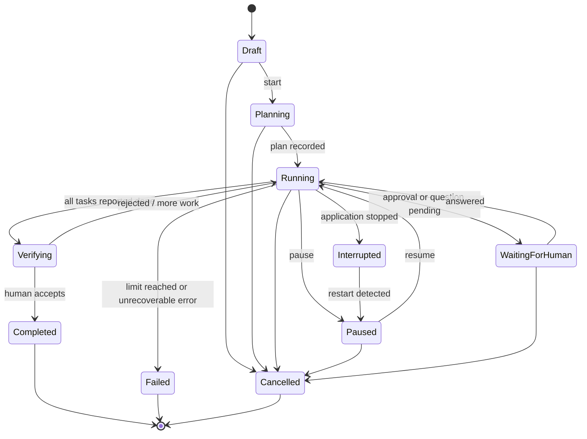
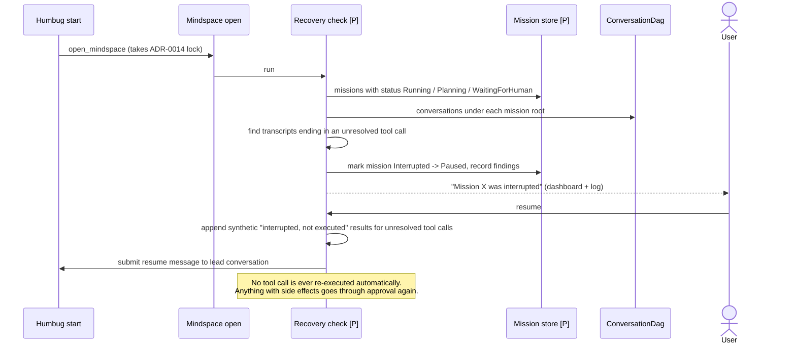

# Humbug Autonomous Mode — Architecture Assessment

Date: 2026-11-02  
Status: Working document supporting [ADR-0021](adr/0021-autonomous-mode.md) (Proposed — Pending Maintainer Review)  
Baseline: branch `dev-autonomous-mode`, commit `448f8c67` (v59)

This is a design and assessment document. Nothing described here as *proposed*
exists in the code. Line numbers refer to the baseline commit and will drift.

Findings are marked:

- **[V]** — verified by reading the repository code or ADRs.
- **[I]** — an inference from the code, not directly demonstrated.
- **[P]** — a proposed component or behaviour. It does not exist today.

---

## 1. Executive summary

Humbug already contains most of the machinery an "Autonomous Mode" needs:

- **Several AI conversations run at once.** Many conversations can stream at the same time on the single qasync loop.
- **Parallel delegation.** One conversation can hand tasks to several child conversations in parallel.
- **Delegation authorisation.** Every delegation needs approval, and resuming a delegated session is checked against `ConversationDag`.
- **A frontend-agnostic layout model.** `ContextRegistry` holds the layout, and the desktop tabs are only a projection of it.
- **An audit log.** It is append-only and fsync'd on every write, and the AI cannot reach it.
- **A single approval primitive.** All approvals go through it.

What is missing is mostly **bounds and visibility**, not an execution engine:

- **No limits.** Delegation has no depth or concurrency limit, and no budget.
- **Approvals need an open tab.** Each approval request is surfaced only by the tab of the conversation that raised it. With no tab, it is never answered.
- **Cancellation doesn't reach children.** Cancelling a conversation does not stop the children it delegated.
- **No record of goals or progress.** Nothing records the objective a group of conversations is pursuing, or how far it has got.
- **No restart handling.** Nothing detects or reports interrupted work after a restart.
- **Bookkeeping lives in the widget.** Usage accounting and the audit record of completed AI messages happen in `ConversationWidget`, not in the backend. A conversation driven without its tab would therefore go unaudited.

Two accepted ADRs constrain the design directly:

- **ADR-0001:** "There is no separate orchestration layer. The model's own planning ability, exercised through tools, is the orchestration." It rejected planners, task graphs and execution engines because they hide steps from the user.
- **ADR-0006:** rejected "a headless agent API alongside a human-only GUI".

**Recommendation.** Adopt **Option B in a conversation-native form**:

- Missions are first-class, mindspace-scoped records.
- Planning and coordination stay inside an AI conversation (a *mission lead*), which uses the existing delegate tool.
- Humbug's backend adds only what a conversation cannot provide for itself:
  - enforced limits;
  - a central inbox over the existing approvals;
  - a persisted mission record;
  - detection of interrupted work after a restart;
  - a mission-oriented view.

No component plans or schedules work on its own. This fits ADR-0001 and ADR-0006 rather than superseding them.

**One part of the brief cannot be decided by this assessment alone.** "Bounded Autopilot" means some state-changing actions run without a prompt at the time they happen. That changes ADR-0007's rule of "explicit user approval before each action". It needs its own maintainer decision. ADR-0019 does not decide it.

---

## 2. Existing architecture findings

### 2.1 Application and framework

- **[V] Stack.** PySide6 with qasync gives a single asyncio loop on the Qt thread.
  - Entry point: `src/desktop/__main__.py`. It sets up `QEventLoop(app)` at lines 293–294 and constructs `MainWindow` at line 297.
  - Only the `desktop` module may import PySide6 or qasync (`dependency-rules.yaml`, ADR-0005).
- **[V] One window per process.**
  - `MainWindow` (`src/desktop/main_window.py:272`) is constructed exactly once.
  - `MindspaceManager`, `UserManager` and `StyleManager` are process singletons (`__new__` at `mindspace_manager.py:56`, `user_manager.py:42`, `style_manager.py:64`).
- **[V] One process per mindspace (ADR-0014).**
  - An exclusive OS lock on `<mindspace>/.humbug/mindspace.lock` enforces it (`MindspaceManager.open_mindspace`, `src/desktop/mindspace/mindspace_manager.py:101`).
  - The lock is taken through `json_store.acquire` (`src/desktop/json_store.py:128`).
  - `~/.humbug/instances/<pid>.json` is advisory only (`src/desktop/user/instance_registry.py:42`).
- **[V] Dependency rules are enforced.**
  - `tools/dependency_checker` keeps the import graph acyclic.
  - No backend module may import `desktop`.

### 2.2 UI components and tab management

- **[V] Tab management.**
  - `TabManager` (`src/desktop/tab_manager/tab_manager.py:33`) renders tabs in up to six columns (`ContextRegistry.MAX_COLUMNS`, `src/context/context_registry.py:36`).
  - Tab factories are registered for conversation, editor, terminal, preview, diff, log, shell and usage (`main_window.py:708-715`).
- **[V] The registry drives the tabs.** `TabManager._subscribe_to_registry` (line 603) reacts to the `ContextRegistry` events OPENED, CLOSED, UPDATED, FOCUSED, MOVED and the column events.
  - A tab is a projection of a registry entry, as the blueprint and ADR-0008 require.
- **[V] Sidebars.** `SidebarManager` (`src/desktop/sidebar_manager/sidebar_manager.py:27`) hosts pluggable panels: conversations, vcs, files, preview, search and trash.
  - The conversations panel shows the delegation and fork tree from `ConversationDag`.
  - **[I]** It shows no live run state.
- **[V] Closest thing to a dashboard today.** The tab overview (`src/desktop/tab_manager/tab_overview.py:296`).
  - It is purely presentational, fed by `TabManager._build_overview_entries` (line 1357).
  - It is tab-centric, not task-centric.
- **[V] Other views.**
  - The log view (`src/desktop/log_tab/log_widget.py:23`) pages through the interaction log.
  - The usage view lives in `src/desktop/usage_tab/`.
- **[V] Theming and shortcuts.**
  - `StyleManager.get_color(ColorRole)` supplies colours.
  - `LanguageManager` provides strings in en, fr and ar.
  - Keyboard shortcuts are hard-coded `QAction`s in `MainWindow.__init__` (lines ~337–540).

### 2.3 Mindspace structure and lifecycle

- **[V] `Mindspace`** (`src/mindspace/mindspace.py:24`) is Qt-free. It owns:
  - settings;
  - the interaction log;
  - path resolution;
  - session persistence;
  - trash;
  - usage;
  - the `ContextRegistry` (line 62);
  - the `AIToolManager` binding.
- **[V] `.humbug/` layout** (lines 31–38): `settings.json`, `session.json`, `usage.json`, `conversations/*.conv`, `trash/`, `log/log-NNNNNNNN.jsonl` and `mindspace.lock`.
- **[V] Switching mindspaces** is: save session, close all tabs, close the mindspace, then open the new one (`main_window.py:1715-1771`).

### 2.4 Conversation and AI execution engine

- **[V] `AIConversation`** (`src/ai/ai_conversation.py`) is one instance per conversation.
  - **States** (lines 26–31): IDLE, STREAMING_AI_RESPONSE, EXECUTING_TOOLS and WAITING_FOR_APPROVAL. **WAITING_FOR_APPROVAL is defined but never assigned.**
  - **Events** (lines 34–51) are delivered to async callbacks held in a set per event, so their order is not defined. Each callback is awaited in turn, and exceptions are logged (lines 120–155).
- **[V] `submit_message`** (lines 281–343) queues the message while the conversation is busy. Otherwise it starts `_start_ai` as a tracked task and returns immediately. Callers learn the outcome through COMPLETED and ERROR events.
- **[V] Tool calls run one after another** within a turn (`_execute_tool_calls`, lines 617–765).
  - A tool may return a `continuation` task. All continuations are awaited together with `asyncio.gather` (lines 695–697).
  - Parallel delegation is built on this.
- **[V] Wrappers.**
  - `AITranscriptConversation` (`src/ai_transcript_conversation/ai_transcript_conversation.py`) persists the conversation to `.conv` JSON. It rewrites the whole file atomically on AI_CONNECTED, MESSAGE_COMPLETED and ERROR (lines 94–126; `ai_conversation_transcript_handler.py:60`).
  - `ConversationContext` (`src/conversation_context/conversation_context.py`) is the context model. Today only the Qt tab creates it (`conversation_tab.py:181-189`).
- **[V] Cancellation.** `cancel_current_tasks` (lines 1201–1234) does all of the following:
  - rejects any pending approval;
  - resolves any interruptible wait;
  - cancels the conversation's tasks;
  - calls `tool.cancel(self)` on every tool;
  - clears queued messages.
- **[V] No automatic recovery.**
  - `retry_last_request` (line 1236) is a manual retry after an error.
  - Nothing repairs or resumes an interrupted turn on load.

### 2.5 AI providers

- **[V] Backends.** `AIManager` (`src/ai/ai_manager.py:37-48`) registers ten provider keys over nine backend classes.
  - `AIBackend.stream_message` (`src/ai/ai_backend.py:195-386`) retries up to six times with exponential backoff, on 429, 5xx and network errors.
- **[V] No global limits.** Nothing limits how many requests run at once or how much they cost across conversations. Each request uses its own `HttpClient`.

### 2.6 Tool registry and execution pipeline

- **[V] Tool base class.** `AITool` (`src/ai_tool/ai_tool.py:20`).
  - Its `@final execute` (lines 96–174) validates the operation and its parameters, then dispatches to the handler with an authorisation callback.
  - `cancel` does nothing by default (line 77). Only `MenaiAITool` overrides it.
- **[V] Tool manager.**
  - `AIToolManager` is a process singleton (`src/ai_tool/ai_tool_manager.py:11-27`). Tools are registered once in `main_window.py:796-841`.
  - The set of enabled tools is global for the mindspace, not per conversation.
  - A delegated child therefore gets every enabled tool, `delegate_ai` included.

### 2.7 Human approval and rejection

- **[V] Approval policy.** ADR-0007 requires approval for changes to persistent state, and none for ephemeral state. The blueprint requires "explicit user approval before each action" for tools with side effects.
- **[V] Approval flow.** A tool awaits `AIConversation._request_tool_authorization` (lines 444–513).
  - That method creates a single pending future, emits `TOOL_APPROVAL_REQUIRED(message, tool_call, reason, context, destructive)` and waits.
  - `approve_pending_tool_calls` and `reject_pending_tool_calls` (lines 767–809) resolve it.
- **[V] Only the conversation's own tab answers approvals** (`conversation_widget.py:1275`, handlers at 1339, 1355 and 1382).
  - **[I]** A conversation with no live tab waits on approval forever.
  - **[V]** The delegate tool swallows any failure to open a child's tab (`delegate_ai_tool.py:662-663`). That makes the hang reachable.
- **[V] What approval looks like for each tool.**

  | Tool | Needs approval | No approval |
  |---|---|---|
  | `filesystem` | writes, deletes, moves, diffs, transforms | reads, listings, searches |
  | `editor` | `save_file` | buffer edits |
  | `terminal` | `send_command`, `write` | — |
  | `http` | every request outside the GET/HEAD allowlist | GET/HEAD on the allowlist |
  | `delegate_ai` | every delegation (not destructive) | — |
  | `system` | closing a modified tab | everything else |

  - **[V]** The `destructive` flag only changes how the Approve button is styled (`conversation_message.py:~849`).
- **[V] Stale approvals are already handled.**
  - A queued user message makes the next request return *denied* without prompting (`ai_conversation.py:469-472`).
  - The widget auto-rejects when a new message is sent (`conversation_widget.py:3547-3552`).
  - Cancelling rejects any pending approval.
- **[V] Rejection reasons don't reach the AI.** The reason the user types is only logged (line 794). The AI sees a fixed denial message instead.

### 2.8 Delegation

- **[V] Starting a child.** `DelegateAITool._run_delegation` (`src/delegate_ai_tool/delegate_ai_tool.py:297-391`):
  1. creates a child `AIConversation`;
  2. persists it as `conversations/dAI-<ts>.conv`;
  3. opens a conversation context with `requester_id` set to the parent;
  4. submits the task;
  5. returns a continuation that waits for the child's COMPLETED or ERROR.
- **[V] Approval and resume.** Every delegation needs approval (line 268); the approval preview shows the task prompt cut to 500 characters. A session can be resumed only by its parent, checked against `ConversationDag` and failing closed (lines 537–605, ADR-0011).
- **[V] No limits.** There is no depth limit, recursion guard or concurrency cap (a grep for depth, Semaphore and max_concurrent finds nothing relevant). Recursion is bounded only by a human approving each step.
- **[V] No cancel override.** `DelegateAITool` doesn't override `cancel`.
  - **[I]** Cancelling the parent cancels its wait for the child, but the child's own `_start_ai` task keeps running.
  - **[I]** The child's tab is closed only on the success path (line 436), so cancelling also leaves the tab open.

### 2.9 Settings and configuration

- **[V] User settings.** `UserSettings` (`src/desktop/user/user_settings.py:20-49`) is stored in `~/.humbug/user-settings.json` and holds:
  - AI backends and API keys;
  - theme and display settings;
  - the filesystem and HTTP allowlists and denylists.
- **[V] Mindspace settings.** `MindspaceSettings` (`src/mindspace/mindspace_settings.py:11`) is stored in `.humbug/settings.json` and holds:
  - the enabled tools;
  - model defaults;
  - editor and terminal options.
- **[V] No policy settings.** There are none for approval, delegation depth, concurrency, budget or retries.

### 2.10 Persistence and session recovery

- **[V] Atomic writes exist only in desktop code.**
  - `json_store.write_json` (`src/desktop/json_store.py:181`) is atomic (temp file then `os.replace`, mode 0600), with no fsync.
  - It lives in `desktop`, so backend modules cannot use it.
- **[V] Some mindspace files are written in place, not atomically.** `session.json` (`mindspace.py:1165`), `usage.json` (line 1342), `settings.json` (`mindspace_settings.py:413`) and the trash manifest.
- **[V] Session state.**
  - It follows ADR-0008: layout, content and view are kept separate.
  - It is saved only when a mindspace is switched or closed, or the window closes (`main_window.py:1723`, `1778`, `3364`). There is no periodic save.
- **[V] The interaction log** (`src/mindspace/mindspace_interactions.py`, ADR-0017) appends JSONL with fsync on every record. Entries for a conversation carry `{"conversation": <path>}`.
- **[V] Who writes the audit record of AI turns.** `ConversationWidget._log_completed_message` (line 1808) writes the log entries for completed AI messages, the "single place the log learns what was said". It also writes the approval and denial entries (lines 1347, 1364, 1390).
  - Usage accounting likewise happens in `ConversationWidget._on_usage_changed` (line 607).
  - **[I]** A conversation driven with no tab is neither audited nor counted for usage.

### 2.11 Multi-window behaviour

- **[V]** Each window is a separate process with exactly one mindspace (ADR-0014).
- **[V]** Global settings propagate between processes by polling a `revision` field (`user_manager.py:304-336`).
- **[I]** "Interface mode" therefore can't differ between windows within one process; one window is one process.

### 2.12 Concurrency and cancellation

- **[V]** Concurrency is cooperative on one event loop. Models don't use locks.
- **[V]** Any number of root conversations can stream at once, and a single turn can start any number of delegated children.
- **[V]** Long tool waits can be interrupted (ADR-0015, `interruptible_sleep`, line 811).
- **[I]** `submit_message` sets the state only once `_start_ai` runs. Two calls in the same tick could therefore start two turns on one history. Today this is reached only by programmatic callers.

### 2.13 Existing ADRs and documentation

| ADR | Relevance to Autonomous Mode |
|---|---|
| 0001 Conversation as primary mode | **Constrains directly:** no separate orchestration layer; the model plans through tools |
| 0003 Local-first | Mission state must live in the mindspace; no service |
| 0004 Minimal dependencies | No workflow engine or queue library |
| 0005 Qt | Backend must stay Qt-free; UI in `desktop` only |
| 0006 Equal actors | **Constrains directly:** no headless AI surface; AI work visible in the same UI |
| 0007 Tool approval policy | **Constrains autonomy:** persistent changes need approval |
| 0008 State ownership | A mission view must be a projection of backend state |
| 0011 Conversation relationships | `ConversationDag` is the single relationship model and the basis for authorisation |
| 0014 Multiple instances | One process and one writer per mindspace |
| 0015 Interruptible waits | The model for pausing and interrupting long waits |
| 0016 HTTP allowlist | Precedent for policy-based automatic approval of read-only actions |
| 0017 Interaction log | The audit trail that every autonomous action must reach |

### 2.14 Menai

- **[V]** Menai is an external sibling package (`menai` 0.8.0), allowed by ADR-0004. It is a pure, functional, Lisp-like language with no I/O, no mutation and no access to the filesystem or network.
- **[V]** In Humbug it is used by `MenaiAITool` (`src/menai_ai_tool/menai_ai_tool.py:22`) with a 10-second timeout, and for filesystem and editor transforms (ADR-0013).
- **[I]** Menai cannot run, wait for or observe anything. At most it could compute a pure function over a plan, such as checking it or choosing the next steps. Plain Python can do that without crossing a language boundary.

---

## 3. Reusable components

| Need | Existing component | Reuse |
|---|---|---|
| Run an AI task | `AIConversation`, `AITranscriptConversation` | As is |
| Start sub-tasks, in parallel | `DelegateAITool` and tool continuations | As is, plus limits |
| Task relationships | `ConversationDag` | As is; the mission links to its root conversation |
| Authorisation to resume a task | ADR-0011 parent check | As is |
| Approvals | `_request_tool_authorization`, `approve/reject_pending_tool_calls` | As is; add a backend subscriber |
| Show work in the UI | `ContextRegistry` and the `TabManager` projection | As is; add a context type for missions |
| Audit trail | `MindspaceInteractions` | As is, once logging moves out of the widget |
| Path confinement | `Mindspace.resolve_tool_path` | As is |
| URL policy | HTTP allowlist and denylist (ADR-0016) | As is |
| Interrupting long waits | `interruptible_sleep` (ADR-0015) | As is |
| Atomic JSON writes | `json_store` | Move to a Qt-free module |
| One writer per mindspace | ADR-0014 lock | As is |
| Display-only widget pattern | `tab_overview.py` | As the pattern for mission views |

---

## 4. Capability gap analysis

| # | Capability | Status | Gap |
|---|---|---|---|
| G1 | Mission record (objective, status, policy, links) | Missing | New, small, persisted per mindspace |
| G2 | Planning | **Exists** (the model, in conversation) | Plan must be recorded in a structured, visible form |
| G3 | Dependency-aware execution | **Partial** (lead delegates in waves; children run in parallel) | Limits on depth, concurrency and count; no dispatcher needed initially |
| G4 | Answer approvals without the tab | **Missing** | Backend approval aggregator (the decision inbox) |
| G5 | Audit and usage for tab-less conversations | **Missing** (in the widget) | Move into the backend first |
| G6 | Cancel cascades to children | **Missing** | Delegate tool must cancel children |
| G7 | Pause and resume | Partial (interruptible waits only) | Mission-level hold at turn and approval boundaries |
| G8 | Restart detection | **Missing** | Detect interrupted missions and unresolved tool calls on open |
| G9 | Bounded retries | Partial (backend retries only) | Task-level retry limits |
| G10 | Evidence-based completion | Missing | Recorded evidence plus human acceptance |
| G11 | Live progress view | Partial (events exist; no aggregate) | Projection over existing events and the log |
| G12 | Mission UI | Missing | New desktop views |
| G13 | Filesystem conflict control between parallel tasks | Missing | Write-scope leases and stale-write detection |
| G14 | Spend and resource limits | Missing | Token budgets per mission |
| G15 | Pre-authorised actions ("autopilot") | Missing, **and contrary to ADR-0007** | Needs a separate decision |

---

## 5. Architecture options

### Option A — UI-only dashboard

A new view that shows existing AI activity: running conversations, pending approvals and the delegation tree. There is no mission model.

### Option B — Native orchestration layer

A mission layer inside the existing backend that reuses conversations, tools and approvals. It has two possible shapes:

- **B1, engine form.** Planner, scheduler and executor services decide and dispatch tasks. The AI fills in steps.
- **B2, conversation-native form.** A mission lead conversation plans and delegates using existing tools. The backend records the mission, enforces limits, aggregates approvals and detects interruptions. No component dispatches work on its own.

### Option C — Independent orchestration runtime

A separate process or service drives Humbug through an interface.

### Comparison

| Criterion | A | B1 (engine) | **B2 (conversation-native)** | C |
|---|---|---|---|---|
| Architectural compatibility | High | **Low**: contradicts ADR-0001 (planners, task graphs, engines rejected) | **High**: orchestration stays in a conversation; extends ADR-0011 delegation | **Very low**: contradicts 0001, 0006 (headless surface), 0014 (single writer), 0003 |
| Security | Unchanged; but can't fix the tab-less approval hang | New decision paths around approvals; a large audit surface | Reuses one approval primitive; adds limits; every action stays in a transcript | A second process holds tool authority; IPC to authenticate; the approval path is duplicated |
| Complexity | Low | High | Medium | Very high |
| Maintainability | High | Low: two sources of execution truth | High: one execution truth (transcripts + DAG) | Low |
| Performance | No change | Scheduler overhead small | No change; adds a global concurrency cap | IPC and serialisation overhead |
| Reliability | No change | New state to reconcile with transcripts | Mission record is thin; transcripts remain the truth | Cross-process consistency, a new failure domain |
| Backwards compatibility | Full | Full if gated | Full; Classic untouched; prerequisites are behaviour-preserving | Full but duplicative |
| Testing | Qt tests | Large new surface | Mostly Qt-free unit tests on small components | Integration-heavy |
| Future extensibility | Limited: no objectives, no recovery | High but rigid | High: an engine form can be added later if evidence shows a need | High in theory |
| Delivers the brief | No: no missions, recovery or bounds | Yes | Yes, except autopilot, which needs a separate decision | Yes |

### Recommendation

**Choose Option B in the B2, conversation-native form.** The reasons, all from the repository:

1. **Parallel delegated execution already exists.** `DelegateAITool` and tool continuations already provide it (`ai_conversation.py:695-697`). The scheduler B1 would add duplicates "judgement the LLM exercises better in context", which ADR-0001 explicitly rejects.
2. **The real gaps are bounds and visibility,** not execution: G4, G5, G6, G8 and G13–G14. Each is a small backend component that is easy to test.
3. **B2 keeps every action in a transcript and the audit log.** That preserves transparency (ADR-0001), the equal-actors principle (ADR-0006) and auditability (blueprint, ADR-0017).
4. **Option A is a useful first deliverable** but cannot meet the objective on its own. Option C conflicts with four accepted ADRs.

B2 still adds *something* the ADR-0001 authors might call orchestration: the mission record and its limits. ADR-0019 states this explicitly and invites the maintainer to confirm that limits and records, unlike planners and dispatchers, sit within ADR-0001.

---

## 6. Proposed target architecture

### 6.1 Assessment of the ten logical components

| # | Component | Verdict | Realisation |
|---|---|---|---|
| 1 | Mission Manager | **Needed, small [P]** | `mission` backend module: create, transition and persist missions; one per mindspace instance |
| 2 | Objective Planner | **Not a component.** The model plans | The mission lead conversation, instructed by a mission system prompt; the plan is recorded through a new `mission` AI tool |
| 3 | Task Scheduler | **Not a component initially** | Lead conversation sequences delegations; backend **Limits** (depth, concurrent children, total tasks, tokens) are enforced in the delegate path |
| 4 | Execution Adapter | **Exists**: `DelegateAITool` | Add mission tagging, cancel propagation and limits |
| 5 | Decision Inbox | **Needed [P]** | Backend `ApprovalHub`: subscribes to `TOOL_APPROVAL_REQUIRED` on every live conversation in the mindspace; approve/reject call the existing methods. Also fixes the tab-less hang |
| 6 | Recovery Coordinator | **Needed, detection only [P]** | On mindspace open: find missions marked running and transcripts ending in an unresolved tool call; mark them *interrupted*; **never re-execute** a tool call automatically |
| 7 | Verification Service | **Partly needed [P]** | Evidence recorded through the `mission` tool (file paths, test output references); optional delegated verifier conversation; human acceptance closes the mission |
| 8 | Mission State Store | **Needed, small [P]** | `.humbug/missions/<id>.json`, atomic replace; transcripts and DAG remain the execution truth |
| 9 | Activity Monitor | **Projection, no new store [P]** | Aggregates `AIConversationEvent`s and interaction-log entries tagged with mission and conversation |
| 10 | Autonomous UI | **Needed [P]** | Desktop views that only render backend state and trigger backend operations |

### 6.2 Prerequisite moves (behaviour-preserving)

These benefit Classic Mode too. They come first because without them a conversation driven without its tab is unaudited.

- **P1.** Move `json_store` from `desktop` to a Qt-free module. It has no Qt imports. Then use it for `session.json`, `usage.json` and `settings.json`.
- **P2.** Move usage accounting out of `ConversationWidget._on_usage_changed` into the backend (`AITranscriptConversation` or a mindspace-level subscriber).
- **P3.** Move the audit logging of completed messages and approval decisions out of `ConversationWidget` into the backend. The log must not depend on a widget existing.
- **P4.** Make `DelegateAITool` cancel its children and always close their contexts (in a `finally` block).
- **P5.** Assign `ConversationState.WAITING_FOR_APPROVAL`, so that both the inbox and the UI can see which conversations are blocked.
- **P6.** Make `submit_message` claim the busy state synchronously, closing the double-start window identified in §2.12.

### 6.3 Module placement [P]

- A new top-level Qt-free module `mission`, registered in `dependency-rules.yaml`.
  - Depends on `ai`, `ai_tool`, `mindspace`, `conversation_dag` and `context`.
  - Never on `desktop`.
- A new `mission_ai_tool` with the operations `record_plan`, `update_task`, `report_evidence`, `request_human`. Recording is ephemeral mission bookkeeping, so it needs no approval under ADR-0007.
- Desktop views live under `src/desktop/mission/`. They follow the pattern of `tab_overview.py`: display records in, signals out, and a mediator calls the backend.

---

## 7. Diagrams

Throughout, solid boxes are implemented components and dashed boxes are proposed.

### 7.1 Existing Humbug architecture



### 7.2 Proposed target architecture

```mermaid
flowchart TB
    subgraph desktop["desktop — renders and triggers only"]
        CT[ConversationTab]
        MV[Mission views<br/>Dashboard, Inbox, Task graph]:::proposed
        MED[Mission mediator]:::proposed
    end

    subgraph backend["Qt-free backend"]
        subgraph mission["mission module"]:::proposed
            MMGR[MissionManager]:::proposed
            STORE[Mission store<br/>.humbug/missions]:::proposed
            LIM[Limits]:::proposed
            HUB[ApprovalHub]:::proposed
            REC[Recovery check]:::proposed
            ACT[Activity projection]:::proposed
        end
        MT[mission_ai_tool]:::proposed
        AC[AIConversation]
        ATC[AITranscriptConversation<br/>+ usage, audit]
        DT[DelegateAITool<br/>+ limits, cancel cascade]
        DAG[ConversationDag]
        CR[ContextRegistry]
        MI[MindspaceInteractions]
    end

    MV --> MED --> MMGR
    MED --> HUB
    CT --> AC
    MMGR --> STORE
    MMGR -- opens lead conversation --> CR
    MMGR --> AC
    MT --> MMGR
    DT --> LIM
    DT --> AC
    HUB -- subscribes TOOL_APPROVAL_REQUIRED --> AC
    HUB -- approve / reject --> AC
    ATC --> MI
    REC --> STORE
    REC --> DAG
    ACT --> MI
    ACT --> AC

    classDef proposed stroke-dasharray: 5 5
```

### 7.3 Classic Mode vs Autonomous Mode



### 7.4 Mission planning and execution



### 7.5 Task dependency graph (example)



The lead delegates T1, then T2, T3 and T4 together in one turn (they run in parallel as continuations), then T5. The dependency graph is part of the recorded plan. The lead follows it; the backend checks that a task is not marked done before its dependencies are done.

### 7.6 Human approval workflow



The same primitive is resolved from either surface. Whichever answers first wins, and the other surface clears. A decision is bound to the conversation and the tool-call message, so a stale inbox entry cannot approve a later request.

### 7.7 Mission lifecycle



### 7.8 Application restart and recovery



---

## 8. Critical design decisions

| Question | Recommendation | Evidence / reason |
|---|---|---|
| Missions as first-class entities? | **Yes**, but thin: objective, policy, status, plan and links to conversations. Execution truth stays in transcripts and the DAG | ADR-0001 rejects a second synced state; ADR-0011 makes the DAG the relationship model |
| Per mindspace or across mindspaces? | **Per mindspace** | ADR-0014 single writer and lock; `resolve_tool_path` confines tools; the audit log is per mindspace. Cross-mindspace work would need two processes to coordinate, which ADR-0014 avoided |
| Interface mode scope? | **User-wide default with a per-window runtime switch** | One window is one process and one mindspace (ADR-0014), so per-window equals per-mindspace at run time. Stored in user settings as the default; the View menu switches the current window |
| Autonomy scope? | **Per mission, capped by a per-mindspace maximum** | Keeps interface mode and autonomy separate, as the brief requires |
| Coordinating many conversations | Parent-child delegation only; children report to the lead; no peer messaging | Matches the delegate tool and the ADR-0011 resume check |
| Avoiding filesystem conflicts | Each delegated task declares a **write scope** (path globs). The backend grants non-overlapping leases among running tasks and refuses writes outside the lease. Writes also check that the file hasn't changed since it was read | `resolve_tool_path` is the single choke point for paths. Terminal commands cannot be scoped, so in missions they always need approval and are labelled as unscoped |
| Approvals in both modes | One primitive, two surfaces: the inline tab UI and the inbox, both via `ApprovalHub` | Avoids a second approval path |
| Sharing execution state between interfaces | Backend models plus callbacks; the UI only renders | ADR-0008, the blueprint, and the remote-access direction |
| Persisting mission state | `.humbug/missions/<id>.json`, atomic replace (P1); mission events in the interaction log | ADR-0003, ADR-0017 |
| Resuming without duplicate execution | Never replay tool calls; mark unresolved ones as not executed; resume needs a human action | Tool calls are not idempotent (terminal, HTTP POST, file moves) |
| Menai's role | **None in the core.** Possibly later: user-authored pure policy predicates | Menai has no I/O and a 10s timeout; Python validation is simpler (YAGNI) |
| Pause / resume / cancel / take over | **Pause:** no new turn or delegation starts; running turns finish at their next boundary. **Cancel:** cascades to children (P4). **Take over:** opening the conversation and typing marks the task *human-controlled*, and the lead is told | ADR-0015 interrupts; `cancel_current_tasks`; the ADR-0006 equal-actor model |

---

## 9. Security assessment

### 9.1 Invariant

> The effective authority of any autonomous action is at most the authority the
> same action has in Classic Mode. Mission policy may only **narrow** that authority.
> The only exception is pre-authorisation, which needs a separate decision (§9.3).
> Even pre-authorisation can only turn a *prompt* into a human approval given earlier.
> It can never turn a *deny* into an *allow*.

### 9.2 Threats

| Threat | Current state | Proposed control |
|---|---|---|
| Approval bypass | **[V]** Only UI handlers resolve approvals; no tool can | `ApprovalHub` calls the same methods; no tool may reach the hub; `mission_ai_tool` has no approval operation |
| Privilege escalation by delegation | **[V]** Child gets every enabled tool, and its own approvals | Child's tool set ⊆ the parent's and the mission policy's; depth and count limits; ADR-0011 resume check kept |
| Prompt injection (files, web, child results) | **[I]** Child results and fetched content enter the lead's context unfiltered | Policy limits what an injected instruction can do: approvals, leases, limits. Child results are labelled as data in the lead prompt. Destructive actions are never pre-authorised |
| Cross-mindspace isolation | **[V]** `resolve_tool_path` and the ADR-0014 lock | Missions are per mindspace; no cross-mindspace references |
| Concurrent filesystem changes | **[V]** No coordination | Write-scope leases and stale-write checks; terminal always prompts in missions |
| Destructive operations | **[V]** The `destructive` flag only changes button styling | Destructive operations always need a fresh human decision in every autonomy level |
| Stale or duplicated approvals | **[V]** Existing auto-reject on new message and on cancel | Inbox decisions bound to (conversation, tool-call message id); the hub checks the request is still pending before resolving |
| Recursive task creation | **[V]** Unbounded except by human approval | Depth limit, total task limit, children-per-task limit |
| Infinite retry loops | **[V]** Backend retries bounded at 6; no task-level bound | Per-task retry limit; repeated identical failures stop the mission and ask a human |
| Resource exhaustion | **[V]** No concurrency or spend limit | Global concurrent-turn limit; per-mission token budget using `AIUsage` |
| Secret exposure | **[V]** Terminal inherits `os.environ` (`unix_terminal.py:55`); TOOL_CALL messages contain raw arguments; `~/.humbug/**` is on the user-editable denylist | No new exposure from missions; mission records hold no secrets; flag the terminal environment as an existing risk that autonomy makes more serious |
| Unsafe cancellation | **[I]** Children keep running after the parent is cancelled | Cancel cascade (P4); tool `cancel` hooks |
| Crash recovery | **[V]** No detection | Detect-only recovery; never re-execute |
| Audit gaps | **[I]** Tab-less conversations unaudited | P3 before any autonomous feature |
| HTTP state-changing requests | **[V]** POST/PUT/PATCH/DELETE/download skip the URL denylist (only GET/HEAD call `_check_url_access`, `http_ai_tool.py:590, 623, 665`) | Existing gap; fix before any pre-authorisation of HTTP is considered |

### 9.3 Autonomy levels against ADR-0007

| Level | Behaviour | Compatible with ADR-0007? |
|---|---|---|
| **Assist** | Missions organise work; every approval behaves exactly as in Classic | Yes |
| **Supervised** | As Assist, plus approvals collected in the inbox with notifications. Delegation within mission limits still asks for approval | Yes |
| **Bounded Autopilot** | At mission start the user confirms a finite, displayed **standing approval**, e.g. "write files under `src/foo/**`", "delegate up to 5 children, depth 2", "GET to allowlisted hosts". It expires with the mission and can be revoked. Destructive operations, terminal commands and non-GET HTTP are never covered | **No.** It replaces "approval before each action" with approval in advance. Requires a separate ADR amending ADR-0007 |

ADR-0016 (allowlisted GET/HEAD) and the external-read allowlist show that policy-based approval already exists for *read-only* actions. Bounded Autopilot would extend that to some writes. That is a policy change for the maintainer, not an implementation detail.

---

## 10. Compatibility analysis

- **Classic is the default.** With interface mode Classic and no missions, behaviour is unchanged apart from the prerequisite moves.
- **The prerequisites (P1–P6) preserve behaviour.** Each needs tests showing Classic is unaffected. P2 and P3 change where logging and usage happen, not what is recorded.
- **Storage.**
  - New files live under `.humbug/missions/`. They are covered by the existing `.humbug/.gitignore` (`*`), and AI tools cannot reach them (`is_humbug_path`).
  - The transcript format is unchanged; mission links live in the mission record, not in `.conv` files.
- **Older versions.** A mindspace opened by an older Humbug ignores `.humbug/missions/`.
- **Remote access.** ADR-0018 (remote access, on another branch) puts all behaviour in the backend. `ApprovalHub` and the mission models fit that direction, and could later be exposed to a remote client without a desktop dependency.

---

## 11. Risks and mitigations

| Risk | Likelihood | Impact | Mitigation |
|---|---|---|---|
| Prerequisite moves regress Classic (conversation engine is load-bearing, ADR-0001) | Medium | High | Tests first; one move per change; no behaviour change |
| Lead conversation plans poorly or loses track over long missions | Medium | Medium | Plan recorded as structured state the lead can re-read; human checkpoints; limits |
| Users over-trust autopilot | Medium | High | Autopilot gated behind a separate ADR; destructive never pre-approved; standing approvals visible and revocable |
| Parallel tasks corrupt files | Medium | High | Leases and stale-write checks; terminal always prompts |
| Cost overrun | Medium | Medium | Token budget per mission; global concurrency cap |
| Inbox and tab race on the same approval | Low | Medium | One primitive; checks the request is still pending; first answer wins |
| Recovery misreads a transcript | Low | Medium | Detect-only; human resumes; never re-execute |
| Scope creep toward an engine (B1) | Medium | Medium | ADR-0019 records the boundary; an engine needs a new ADR |

---

## 12. Phased roadmap (proposal only — not to be started without approval)

Each phase is shippable on its own and leaves Classic unchanged.

### Phase 1 — Settings and safe interface switching

- **Scope:**
  - prerequisites P1–P6;
  - an interface-mode setting (user default plus a per-window View switch);
  - an autonomy maximum per mindspace (Assist and Supervised only);
  - an empty Autonomous workspace that can switch back to Classic.
- **Dependencies:** none.
- **Risks:** regressions in the conversation engine.
- **Acceptance:**
  - every existing test passes;
  - a conversation driven without a tab is audited and counted for usage;
  - cancelling a parent stops its children;
  - switching modes changes nothing about open conversations.
- **Validation:** new Qt-free tests for P2–P6, the existing Classic suite, and a manual check of the mode switch.

### Phase 2 — Mission dashboard and decision inbox

- **Scope:**
  - `ApprovalHub`;
  - the inbox view;
  - a dashboard of live conversations and the delegation tree. This is Option A, delivered on the B2 foundation.
- **Dependencies:** Phase 1.
- **Risks:** stale decisions; duplicate surfaces.
- **Acceptance:**
  - an approval raised by a conversation with no open tab can be answered from the inbox;
  - answering in one surface clears the other;
  - stale decisions are refused.
- **Validation:** Qt-free hub tests, including race cases, and Qt view tests.

### Phase 3 — Mission model, planning and persistence

- **Scope:**
  - the `mission` module and store;
  - `mission_ai_tool`;
  - a lead-conversation system prompt;
  - mission creation UI;
  - the task graph view.
- **Dependencies:** Phase 2.
- **Risks:** plan quality; the store drifting from transcripts.
- **Acceptance:**
  - a mission persists across restart;
  - the plan is visible in both the transcript and the dashboard;
  - deleting a mission never deletes conversations without confirmation.
- **Validation:** store round-trip tests, plan validation tests, and a scripted mission with a mock backend.

### Phase 4 — Native orchestration and task scheduling

- **Scope:**
  - limits (depth, children, total tasks, concurrent turns, token budget);
  - write-scope leases;
  - pause, resume, cancel and take over.
- **Dependencies:** Phase 3.
- **Risks:** limits too strict or too loose; lease false positives.
- **Acceptance:**
  - limits are enforced and reported, not silent;
  - overlapping writes are refused;
  - pause stops new work within one turn;
  - take-over stops autonomous messages to that conversation.
- **Validation:** Qt-free unit tests for limits and leases; concurrency tests on the event loop.

### Phase 5 — Recovery, verification and artifact tracking

- **Scope:**
  - the restart check;
  - synthetic "not executed" results;
  - evidence recording;
  - a verifier delegate;
  - human acceptance.
- **Dependencies:** Phase 4.
- **Risks:** misread transcripts.
- **Acceptance:**
  - killing Humbug during a mission leaves the mission Paused with its findings shown after restart;
  - no tool call runs twice.
- **Validation:** crash-injection tests with recorded transcripts.

### Phase 6 — Security hardening, regression testing and release readiness

- **Scope:**
  - a threat-model review;
  - fix the HTTP denylist gap for state-changing methods;
  - limit the terminal environment;
  - fuzz approval races;
  - documentation.
  - Bounded Autopilot is **only** taken up if its separate ADR is accepted.
- **Dependencies:** Phase 5.
- **Risks:** pressure to ship autopilot early.
- **Acceptance:** each invariant in §9 has a test; nothing in the audit trail is missing for a scripted mission.
- **Validation:** security review, full regression suite, and a manual end-to-end check on all three operating systems (ADR-0002).

---

## 13. Open questions

1. Does the maintainer agree that mission records and enforced limits sit within ADR-0001, or should ADR-0001 be explicitly amended?
2. Should Bounded Autopilot be pursued at all? If so, which operation classes are eligible for standing approval?
3. Should the lead conversation be a normal conversation the user can also type into, or a dedicated read-only one?
4. Should delegated children in a mission get a narrower tool set by default, for example no terminal unless the mission policy allows it?
5. What are acceptable default limits: depth, children, concurrent turns and token budget?
6. Should rejection reasons start reaching the AI (today they are only logged), since autonomy relies more on feedback?
7. Should the terminal stop inheriting the full environment, independently of this work?
8. Should mission records travel with conversation move and delete operations (the `compute_operation_scope` semantics)?
9. Is the per-window interface-mode switch wanted, or a user-wide setting only?
